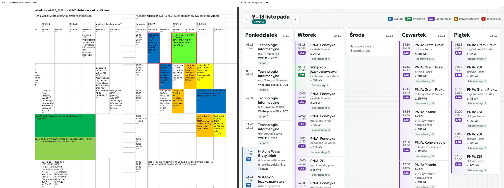
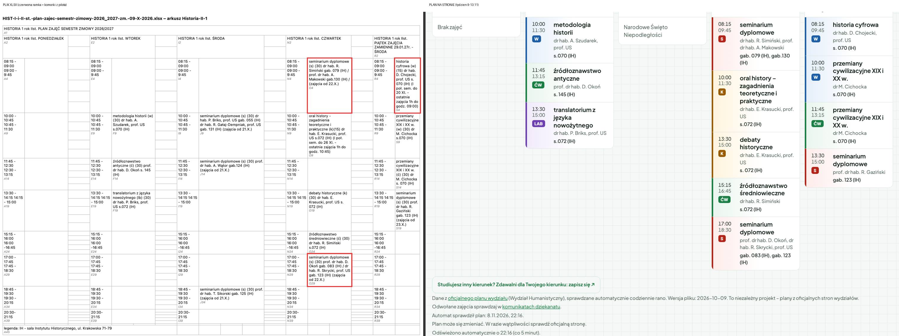

# Pilot WH (Etap 4): 10 losowych zajęć z pliku i z planu

Wygenerowane 2026-11-08: `node scripts/us/wh-pilot.mjs --ziarno 42`. Kierunki pilota: HIST, FA. Wszystkich zajęć: 271.
Kolumna „plik” = tekst komórki dokładnie jak w XLSX (arkusz, komórka); „plan” = to, co trafiło do plan/<id>.json i na stronę.

## Plik obok strony

Lewa strona: arkusz XLSX narysowany jako tabela ze scaleniami (czerwona ramka = komórki z porównania), prawa: plan na stronie w tygodniu 9–13.11 (11.11 – święto).

## Jakość odczytu całego pilota

| zajęcia | z notką (dopisek albo terminy nie do odczytania) | rodzaj nieznany (X) | bez prowadzącego | bez sali |
|---|---|---|---|---|
| 271 | 41 | 19 | 9 | 10 |

Rodzaj „X” = plik nie podaje rodzaju (np. „Technologie informacyjne (15h)”); bez prowadzącego/sali = komórka ich nie ma (np. wykład ogólnouczelniany „zgodnie z wyborem”).

## Losowe zajęcia

## 1. wh-fa-2-st-2025 · arkusz „FA 2 rok II st.” · komórka G31

**Plik:** II rok MA specj. naucz. (30 w): Dydaktyka przedmiotu w szkole ponadpodstawowej, dr P. Kamińska, prof. US, s. 16 WH

| dzień | godziny | przedmiot | rodzaj | prowadzący | sala | podgrupa | terminy | notka |
|---|---|---|---|---|---|---|---|---|
| wt. | 17:00–18:30 | Dydaktyka przedmiotu w szkole ponadpodstawowej | W | dr P. Kamińska, prof. US | s. 16 WH | spec:nauczycielska | co tydzień |  |

## 2. wh-fa-2-st-2026 · arkusz „FA 1 rok II st.” · komórka T33

**Plik:** I rok MA gr lab 1 (60h) PNJA: Podst. jęz. biznesu dr Antoni Górny sala 213 WH

| dzień | godziny | przedmiot | rodzaj | prowadzący | sala | podgrupa | terminy | notka |
|---|---|---|---|---|---|---|---|---|
| czw. | 17:00–20:15 | PNJA: Podst. jęz. biznesu | LAB | dr Antoni Górny | s. 213 WH | lab:1 | co tydzień |  |

## 3. wh-hist-2-st-2026 · arkusz „Historia-II-1” · komórka S14

**Plik:** przemiany cywilizacyjne XIX i XX w. (ć) (30) dr M. Cichocka s. 070 (IH)

| dzień | godziny | przedmiot | rodzaj | prowadzący | sala | podgrupa | terminy | notka |
|---|---|---|---|---|---|---|---|---|
| pt. | 11:45–13:15 | przemiany cywilizacyjne XIX i XX w. | CW | dr M. Cichocka | s. 070 (IH) | cały rok | co tydzień |  |

## 4. wh-hist-1-st-2025 · arkusz „Historia-I-2” · komórka F10

**Plik:** emisja głosu (ć) (20) prof. dr hab. L. Mariak al.Piastów 40b, bud. nr 4, s. 220 (WH) w terminie: 06.X. - 08.XII. (zajęcia łączone z matematyką)

| dzień | godziny | przedmiot | rodzaj | prowadzący | sala | podgrupa | terminy | notka |
|---|---|---|---|---|---|---|---|---|
| wt. | 10:00–11:30 | emisja głosu | CW | prof. dr hab. L. Mariak | al.Piastów 40b, bud. nr 4, s. 220 (WH) | spec:kpdwzn | 10 dat: 2026-10-06, 2026-10-13, 2026-10-20 … 2026-12-08 | zajęcia łączone z matematyką |

## 5. wh-hist-1-st-2025 · arkusz „Historia-I-2” · komórka O28

**Plik:** 17:45-19:30 wykład ogólnouczelniany [moduł] przedmiot do wyboru (w) (15) (e-zajęcia)

| dzień | godziny | przedmiot | rodzaj | prowadzący | sala | podgrupa | terminy | notka |
|---|---|---|---|---|---|---|---|---|
| czw. | 17:45–19:30 | ogólnouczelniany przedmiot do wyboru (e- ) | W | — | — | cały rok | co tydzień |  |

## 6. wh-hist-1-st-2025 · arkusz „Historia-I-2” · komórka B13

**Plik:** 11:30-13:00 język łaciński (lk) (30) dr M. Cieśluk s.070 (IH)

| dzień | godziny | przedmiot | rodzaj | prowadzący | sala | podgrupa | terminy | notka |
|---|---|---|---|---|---|---|---|---|
| pon. | 11:30–13:00 | język łaciński | CW | dr M. Cieśluk | s.070 (IH) | cały rok | co tydzień |  |

## 7. wh-fa-2-st-2026 · arkusz „FA 1 rok II st.” · komórka T23

**Plik:** I rok MA gr lab 1 (12h) od 05.11.2026 PNJA: Sztuka prezentacji mgr Irina Sklema, s. 217 WH

| dzień | godziny | przedmiot | rodzaj | prowadzący | sala | podgrupa | terminy | notka |
|---|---|---|---|---|---|---|---|---|
| czw. | 13:30–15:00 | PNJA: Sztuka prezentacji | LAB | mgr Irina Sklema | s. 217 WH | lab:1 | 13 dat: 2026-11-05, 2026-11-12, 2026-11-19 … 2027-01-28 |  |

## 8. wh-fa-1-st-2026 · arkusz „FA I rok” · komórka AJ5

**Plik:** I rok gr lab A (30h) PNJA: Gram. Prakt. mgr Wioletta Szóstak sala 113 WH

| dzień | godziny | przedmiot | rodzaj | prowadzący | sala | podgrupa | terminy | notka |
|---|---|---|---|---|---|---|---|---|
| pt. | 08:15–09:45 | PNJA: Gram. Prakt. | LAB | mgr Wioletta Szóstak | s. 113 WH | lab:A | co tydzień |  |

## 9. wh-fa-1-st-2026 · arkusz „FA I rok” · komórka L5

**Plik:** I rok gr lab A (30h) PNJA: Fonetyka dr Maria Brenda sala 215 WH

| dzień | godziny | przedmiot | rodzaj | prowadzący | sala | podgrupa | terminy | notka |
|---|---|---|---|---|---|---|---|---|
| wt. | 08:15–09:45 | PNJA: Fonetyka | LAB | dr Maria Brenda | s. 215 WH | lab:A | co tydzień |  |

## 10. wh-fa-1-st-2025 · arkusz „FA II rok” · komórka M26

**Plik:** zajęcia od 15.15 - 17.45 (3 godz.) II rok lektorat (30h) GR 2 język hiszpański mgr Joanna Kurdelska sala 101 WH w dniach 20.10, 27.10, 10.11, 17.11, 24.11., 8.12., 15.12, 22.12., 19.01.,

| dzień | godziny | przedmiot | rodzaj | prowadzący | sala | podgrupa | terminy | notka |
|---|---|---|---|---|---|---|---|---|
| wt. | 15:15–17:45 | lektorat język hiszpański | CW | mgr Joanna Kurdelska | s. 101 WH | gr:2 | 9 dat: 2026-10-20, 2026-10-27, 2026-11-10 … 2027-01-19 |  |
