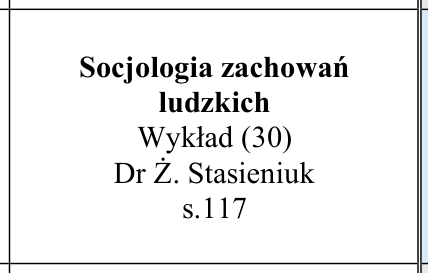
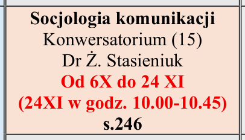
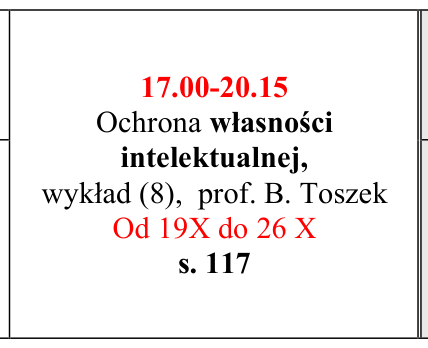
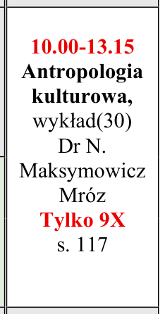
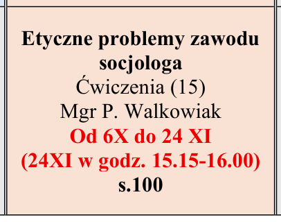
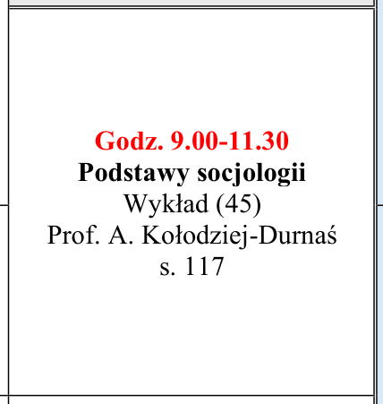
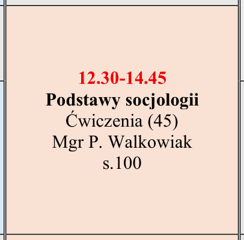
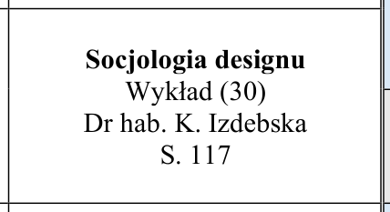
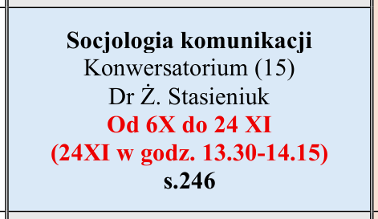
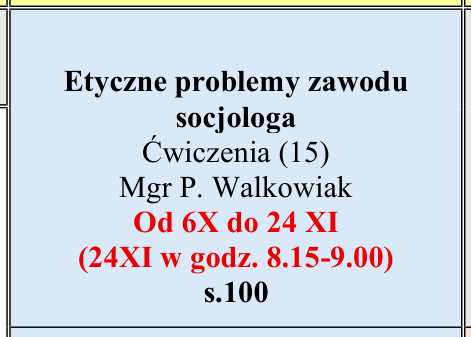

# Pilot WNS (Etap 5): 10 losowych zajęć z SOC-1-25.pdf

Wygenerowane 2026-11-08: `node scripts/us/wpia-pilot.mjs --wydzial wns --plik SOC-1-25.pdf`. Parser: `scripts/us/wns-pdf.mjs`. Wszystkich zajęć w pliku: 13.
Przy każdym: wycinek PDF-u z tą komórką i to, co odczytał parser. Ten plan NIE jest na stronie – czeka w kolejce zatwierdzeń.

**Wynik: 10/10 zgodnych z PDF** (dzień, godziny, przedmiot, rodzaj, grupa, prowadzący, sala, terminy, wyjątki w notce) – porównane
z wycinkami poniżej 9.11.2026. Czerwone godziny w komórce („Godz. 9.00-11.30”, „12.30-14.45”) mają pierwszeństwo przed blokiem siatki.
Oprócz pilota sprawdzone ręcznie z PDF: Psychologia 1 rok (poniedziałek, grupy 11–14 i laby L.1–L.8) i Bezpieczeństwo narodowe
(strony 1–2: specjalności BP/WiBM, grupy 11–13) – zgodne; oba w testach (`scripts/us-wns.test.mjs`).

## 1. pon. 13:30–15:00 · Socjologia zachowań ludzkich

| dzień | godziny | przedmiot | rodzaj | podgrupa | prowadzący | sala | terminy | notka |
|---|---|---|---|---|---|---|---|---|
| pon. | 13:30–15:00 | Socjologia zachowań ludzkich | W | cały rok | dr Ż. Stasieniuk | s. 117 | co tydzień |  |

Tekst komórki: Socjologia zachowań ludzkich Wykład (30) Dr Ż. Stasieniuk s.117

## 2. wt. 10:00–11:30 · Socjologia komunikacji

| dzień | godziny | przedmiot | rodzaj | podgrupa | prowadzący | sala | terminy | notka |
|---|---|---|---|---|---|---|---|---|
| wt. | 10:00–11:30 | Socjologia komunikacji | K | gr:2 | dr Ż. Stasieniuk | s. 246 | 06.10, 13.10, 20.10, 27.10, 03.11, 10.11, 17.11, 24.11 | 24XI w godz. 10.00-10.45 |

Tekst komórki: Socjologia komunikacji Konwersatorium (15) Dr Ż. Stasieniuk Od 6X do 24 XI (24XI w godz. 10.00-10.45) s.246

## 3. pon. 17:00–20:15 · Ochrona własności intelektualnej

| dzień | godziny | przedmiot | rodzaj | podgrupa | prowadzący | sala | terminy | notka |
|---|---|---|---|---|---|---|---|---|
| pon. | 17:00–20:15 | Ochrona własności intelektualnej | W | cały rok | prof. B. Toszek | s. 117 | 19.10, 26.10 |  |

Tekst komórki: 17.00-20.15 Ochrona własności intelektualnej, wykład (8), prof. B. Toszek Od 19X do 26 X s. 117

## 4. pt. 10:00–13:15 · Antropologia kulturowa

| dzień | godziny | przedmiot | rodzaj | podgrupa | prowadzący | sala | terminy | notka |
|---|---|---|---|---|---|---|---|---|
| pt. | 10:00–13:15 | Antropologia kulturowa | W | cały rok | dr N. Maksymowicz Mróz | s. 117 | 09.10 |  |

Tekst komórki: 10.00-13.15 Antropologia kulturowa, wykład(30) Dr N. Maksymowicz Mróz Tylko 9X s. 117

## 5. wt. 15:15–16:45 · Etyczne problemy zawodu socjologa

| dzień | godziny | przedmiot | rodzaj | podgrupa | prowadzący | sala | terminy | notka |
|---|---|---|---|---|---|---|---|---|
| wt. | 15:15–16:45 | Etyczne problemy zawodu socjologa | CW | gr:2 | mgr P. Walkowiak | s. 100 | 06.10, 13.10, 20.10, 27.10, 03.11, 10.11, 17.11, 24.11 | 24XI w godz. 15.15-16.00 |

Tekst komórki: Etyczne problemy zawodu socjologa Ćwiczenia (15) Mgr P. Walkowiak Od 6X do 24 XI (24XI w godz. 15.15-16.00) s.100

## 6. pon. 09:00–11:30 · Podstawy socjologii

| dzień | godziny | przedmiot | rodzaj | podgrupa | prowadzący | sala | terminy | notka |
|---|---|---|---|---|---|---|---|---|
| pon. | 09:00–11:30 | Podstawy socjologii | W | cały rok | prof. A. Kołodziej-Durnaś | s. 117 | co tydzień |  |

Tekst komórki: Godz. 9.00-11.30 Podstawy socjologii Wykład (45) Prof. A. Kołodziej-Durnaś s. 117

## 7. wt. 12:30–14:45 · Podstawy socjologii

| dzień | godziny | przedmiot | rodzaj | podgrupa | prowadzący | sala | terminy | notka |
|---|---|---|---|---|---|---|---|---|
| wt. | 12:30–14:45 | Podstawy socjologii | CW | gr:2 | mgr P. Walkowiak | s. 100 | co tydzień |  |

Tekst komórki: 12.30-14.45 Podstawy socjologii Ćwiczenia (45) Mgr P. Walkowiak s.100

## 8. pon. 11:45–13:15 · Socjologia designu

| dzień | godziny | przedmiot | rodzaj | podgrupa | prowadzący | sala | terminy | notka |
|---|---|---|---|---|---|---|---|---|
| pon. | 11:45–13:15 | Socjologia designu | W | cały rok | dr hab. K. Izdebska | s. 117 | co tydzień |  |

Tekst komórki: Socjologia designu Wykład (30) Dr hab. K. Izdebska S. 117

## 9. wt. 13:30–15:00 · Socjologia komunikacji

| dzień | godziny | przedmiot | rodzaj | podgrupa | prowadzący | sala | terminy | notka |
|---|---|---|---|---|---|---|---|---|
| wt. | 13:30–15:00 | Socjologia komunikacji | K | gr:1 | dr Ż. Stasieniuk | s. 246 | 06.10, 13.10, 20.10, 27.10, 03.11, 10.11, 17.11, 24.11 | 24XI w godz. 13.30-14.15 |

Tekst komórki: Socjologia komunikacji Konwersatorium (15) Dr Ż. Stasieniuk Od 6X do 24 XI (24XI w godz. 13.30-14.15) s.246

## 10. wt. 08:15–09:45 · Etyczne problemy zawodu socjologa

| dzień | godziny | przedmiot | rodzaj | podgrupa | prowadzący | sala | terminy | notka |
|---|---|---|---|---|---|---|---|---|
| wt. | 08:15–09:45 | Etyczne problemy zawodu socjologa | CW | gr:1 | mgr P. Walkowiak | s. 100 | 06.10, 13.10, 20.10, 27.10, 03.11, 10.11, 17.11, 24.11 | 24XI w godz. 8.15-9.00 |

Tekst komórki: Etyczne problemy zawodu socjologa Ćwiczenia (15) Mgr P. Walkowiak Od 6X do 24 XI (24XI w godz. 8.15-9.00) s.100
