# Pilot WNŚiP (Etap 5): 10 losowych zajęć z mat_I-st.-1-rok-akt.-19.10.pdf

Wygenerowane 2026-11-08: `node scripts/us/wpia-pilot.mjs --wydzial wnsip --plik mat_I-st.-1-rok-akt.-19.10.pdf`. Parser: `scripts/us/wnsip-pdf.mjs`. Wszystkich zajęć w pliku: 13.
Przy każdym: wycinek PDF-u z tą komórką i to, co odczytał parser. Ten plan NIE jest na stronie – czeka w kolejce zatwierdzeń.

## PDF obok strony

Cała siatka z PDF-u i tydzień 9–13.11 na stronie planu (atrapa w .cache/, bo prawdziwa strona dostanie plan po zatwierdzeniu). Piątkowa „Wstęp do analizy matematycznej” ma terminy 02.10–23.10, więc 13.11 słusznie jej nie ma.

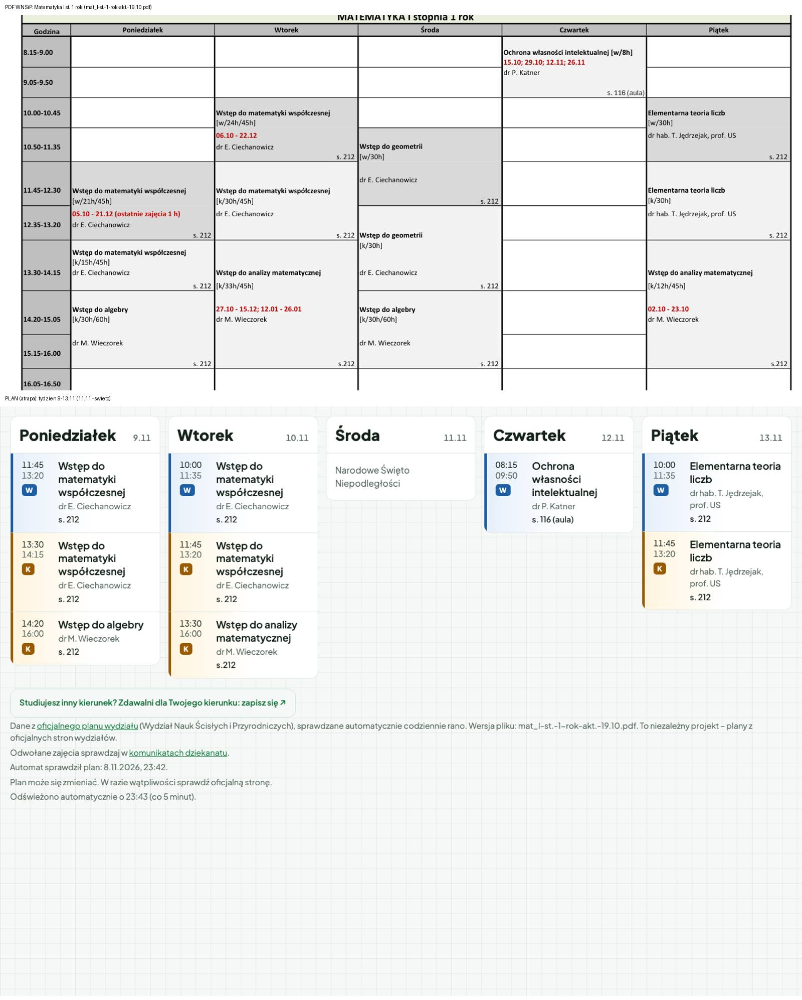

## 1. śr. 12:35–14:15 · Wstęp do geometrii

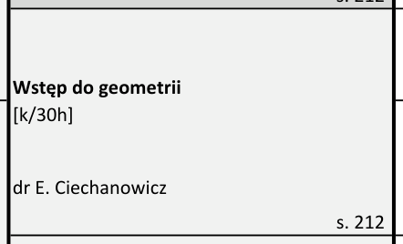

| dzień | godziny | przedmiot | rodzaj | podgrupa | prowadzący | sala | terminy | notka |
|---|---|---|---|---|---|---|---|---|
| śr. | 12:35–14:15 | Wstęp do geometrii | K | cały rok | dr E. Ciechanowicz | s. 212 | co tydzień |  |

Tekst komórki: Wstęp do geometrii [k/30h] dr E. Ciechanowicz s. 212

## 2. wt. 10:00–11:35 · Wstęp do matematyki współczesnej

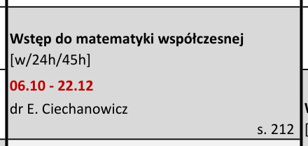

| dzień | godziny | przedmiot | rodzaj | podgrupa | prowadzący | sala | terminy | notka |
|---|---|---|---|---|---|---|---|---|
| wt. | 10:00–11:35 | Wstęp do matematyki współczesnej | W | cały rok | dr E. Ciechanowicz | s. 212 | 06.10, 13.10, 20.10, 27.10, 03.11, 10.11, 17.11, 24.11, 01.12, 08.12, 15.12, 22.12 |  |

Tekst komórki: Wstęp do matematyki współczesnej [w/24h/45h] 06.10 - 22.12 dr E. Ciechanowicz s. 212

## 3. pt. 11:45–13:20 · Elementarna teoria liczb

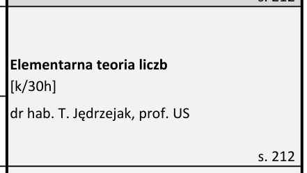

| dzień | godziny | przedmiot | rodzaj | podgrupa | prowadzący | sala | terminy | notka |
|---|---|---|---|---|---|---|---|---|
| pt. | 11:45–13:20 | Elementarna teoria liczb | K | cały rok | dr hab. T. Jędrzejak, prof. US | s. 212 | co tydzień |  |

Tekst komórki: Elementarna teoria liczb [k/30h] dr hab. T. Jędrzejak, prof. US s. 212

## 4. wt. 11:45–13:20 · Wstęp do matematyki współczesnej

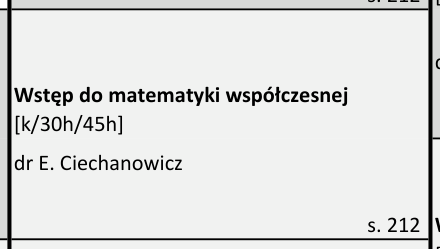

| dzień | godziny | przedmiot | rodzaj | podgrupa | prowadzący | sala | terminy | notka |
|---|---|---|---|---|---|---|---|---|
| wt. | 11:45–13:20 | Wstęp do matematyki współczesnej | K | cały rok | dr E. Ciechanowicz | s. 212 | co tydzień |  |

Tekst komórki: Wstęp do matematyki współczesnej [k/30h/45h] dr E. Ciechanowicz s. 212

## 5. pt. 10:00–11:35 · Elementarna teoria liczb

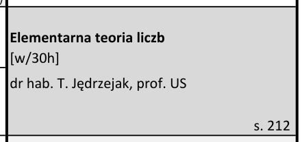

| dzień | godziny | przedmiot | rodzaj | podgrupa | prowadzący | sala | terminy | notka |
|---|---|---|---|---|---|---|---|---|
| pt. | 10:00–11:35 | Elementarna teoria liczb | W | cały rok | dr hab. T. Jędrzejak, prof. US | s. 212 | co tydzień |  |

Tekst komórki: Elementarna teoria liczb [w/30h] dr hab. T. Jędrzejak, prof. US s. 212

## 6. pon. 13:30–14:15 · Wstęp do matematyki współczesnej

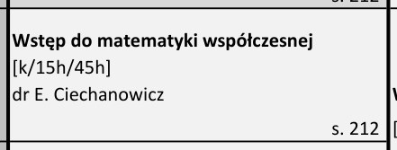

| dzień | godziny | przedmiot | rodzaj | podgrupa | prowadzący | sala | terminy | notka |
|---|---|---|---|---|---|---|---|---|
| pon. | 13:30–14:15 | Wstęp do matematyki współczesnej | K | cały rok | dr E. Ciechanowicz | s. 212 | co tydzień |  |

Tekst komórki: Wstęp do matematyki współczesnej [k/15h/45h] dr E. Ciechanowicz s. 212

## 7. śr. 10:50–12:30 · Wstęp do geometrii

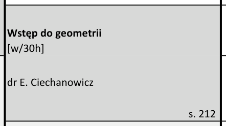

| dzień | godziny | przedmiot | rodzaj | podgrupa | prowadzący | sala | terminy | notka |
|---|---|---|---|---|---|---|---|---|
| śr. | 10:50–12:30 | Wstęp do geometrii | W | cały rok | dr E. Ciechanowicz | s. 212 | co tydzień |  |

Tekst komórki: Wstęp do geometrii [w/30h] dr E. Ciechanowicz s. 212

## 8. wt. 13:30–16:00 · Wstęp do analizy matematycznej

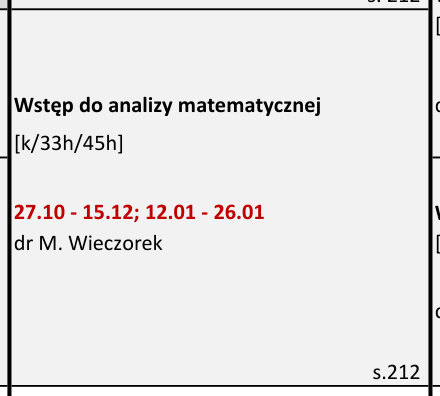

| dzień | godziny | przedmiot | rodzaj | podgrupa | prowadzący | sala | terminy | notka |
|---|---|---|---|---|---|---|---|---|
| wt. | 13:30–16:00 | Wstęp do analizy matematycznej | K | cały rok | dr M. Wieczorek | s.212 | 27.10, 03.11, 10.11, 17.11, 24.11, 01.12, 08.12, 15.12, 12.01, 19.01, 26.01 |  |

Tekst komórki: Wstęp do analizy matematycznej [k/33h/45h] 27.10 - 15.12; 12.01 - 26.01 dr M. Wieczorek s.212

## 9. śr. 14:20–16:00 · Wstęp do algebry

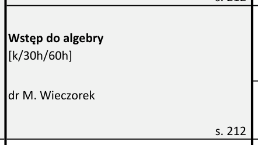

| dzień | godziny | przedmiot | rodzaj | podgrupa | prowadzący | sala | terminy | notka |
|---|---|---|---|---|---|---|---|---|
| śr. | 14:20–16:00 | Wstęp do algebry | K | cały rok | dr M. Wieczorek | s. 212 | co tydzień |  |

Tekst komórki: Wstęp do algebry [k/30h/60h] dr M. Wieczorek s. 212

## 10. pon. 11:45–13:20 · Wstęp do matematyki współczesnej

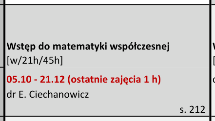

| dzień | godziny | przedmiot | rodzaj | podgrupa | prowadzący | sala | terminy | notka |
|---|---|---|---|---|---|---|---|---|
| pon. | 11:45–13:20 | Wstęp do matematyki współczesnej | W | cały rok | dr E. Ciechanowicz | s. 212 | 05.10, 12.10, 19.10, 26.10, 02.11, 09.11, 16.11, 23.11, 30.11, 07.12, 14.12, 21.12 | (ostatnie zajęcia 1 h) |

Tekst komórki: Wstęp do matematyki współczesnej [w/21h/45h] 05.10 - 21.12 (ostatnie zajęcia 1 h) dr E. Ciechanowicz s. 212
