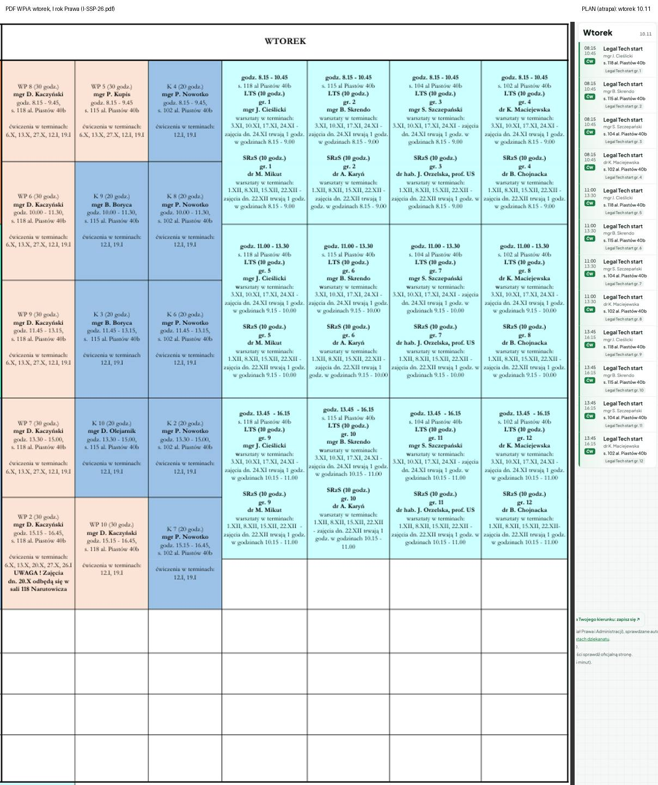
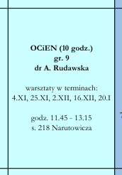
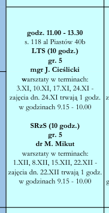
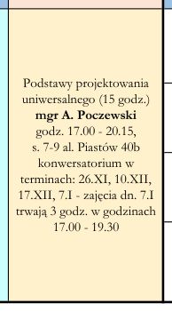
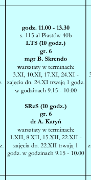
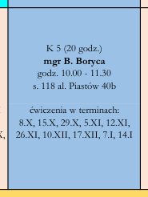
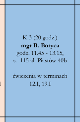
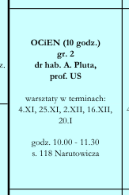
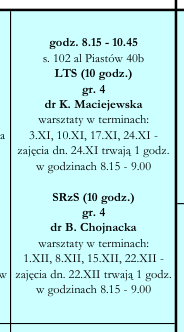
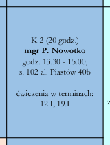

# Pilot WPiA (Etap 5): 10 losowych zajęć z I-SSP-26.pdf

Wygenerowane 2026-11-08: `node scripts/us/wpia-pilot.mjs --plik I-SSP-26.pdf`. Parser: `scripts/us/wpia-pdf.mjs`. Wszystkich zajęć w pliku: 92.
Przy każdym: wycinek PDF-u z tą komórką i to, co odczytał parser. Ten plan NIE jest na stronie – czeka w kolejce zatwierdzeń.

## PDF obok strony

Wtorek z PDF-u i ten sam dzień (10.11) na stronie planu – plan zapisany tylko w atrapie strony (.cache/), bo na prawdziwą stronę trafi po zatwierdzeniu. Wybór podgrup: „wszystkie”, więc widać wszystkie 12 grup warsztatów.

## 1. śr. 11:45–13:15 · Organizacja czasu i efektywna nauka

| dzień | godziny | przedmiot | rodzaj | podgrupa | prowadzący | sala | terminy | notka |
|---|---|---|---|---|---|---|---|---|
| śr. | 11:45–13:15 | Organizacja czasu i efektywna nauka | CW | Organizacja czasu i efektywna nauka:9 | dr A. Rudawska | s. 218 Narutowicza | 04.11, 25.11, 02.12, 16.12, 20.01 |  |

Tekst komórki: OCiEN (10 godz.) gr. 9 dr A. Rudawska warsztaty w terminach: 4.XI, 25.XI, 2.XII, 16.XII, 20.I godz. 11.45 - 13.15 s. 218 Narutowicza

## 2. wt. 11:00–13:30 · Sposoby radzenia ze stresem na studiach

| dzień | godziny | przedmiot | rodzaj | podgrupa | prowadzący | sala | terminy | notka |
|---|---|---|---|---|---|---|---|---|
| wt. | 11:00–13:30 | Sposoby radzenia ze stresem na studiach | CW | Sposoby radzenia ze stresem na studiach:5 | dr M. Mikut | s. 118 al. Piastów 40b | 01.12, 08.12, 15.12, 22.12 | zajęcia dn. 22.XII trwają 1 godz. w godzinach 9.15 - 10.00 |

Tekst komórki: SRzS (10 godz.) gr. 5 dr M. Mikut warsztaty w terminach: 1.XII, 8.XII, 15.XII, 22.XII - zajęcia dn. 22.XII trwają 1 godz. w godzinach 9.15 - 10.00

## 3. czw. 17:00–20:15 · Podstawy projektowania uniwersalnego

| dzień | godziny | przedmiot | rodzaj | podgrupa | prowadzący | sala | terminy | notka |
|---|---|---|---|---|---|---|---|---|
| czw. | 17:00–20:15 | Podstawy projektowania uniwersalnego | K | cały rok | mgr A. Poczewski | s. 7-9 al. Piastów 40b | 26.11, 10.12, 17.12, 07.01 | zajęcia dn. 7.I trwają 3 godz. w godzinach 17.00 - 19.30 |

Tekst komórki: Podstawy projektowania uniwersalnego (15 godz.) mgr A. Poczewski godz. 17.00 - 20.15, s. 7-9 al. Piastów 40b konwersatorium w terminach: 26.XI, 10.XII, 17.XII, 7.I - zajęcia dn. 7.I trwają 3 godz. w godzinach 17.00 - 19.30

## 4. wt. 11:00–13:30 · Sposoby radzenia ze stresem na studiach

| dzień | godziny | przedmiot | rodzaj | podgrupa | prowadzący | sala | terminy | notka |
|---|---|---|---|---|---|---|---|---|
| wt. | 11:00–13:30 | Sposoby radzenia ze stresem na studiach | CW | Sposoby radzenia ze stresem na studiach:6 | dr A. Karyń | s. 115 al. Piastów 40b | 01.12, 08.12, 15.12, 22.12 | zajęcia dn. 22.XII trwają 1 godz. w godzinach 9.15 - 10.00 |

Tekst komórki: SRzS (10 godz.) gr. 6 dr A. Karyń warsztaty w terminach: 1.XII, 8.XII, 15.XII, 22.XII - zajęcia dn. 22.XII trwają 1 godz. w godzinach 9.15 - 10.00

## 5. czw. 10:00–11:30 · Prawo konstytucyjne - zasady i źródła prawa

| dzień | godziny | przedmiot | rodzaj | podgrupa | prowadzący | sala | terminy | notka |
|---|---|---|---|---|---|---|---|---|
| czw. | 10:00–11:30 | Prawo konstytucyjne - zasady i źródła prawa | CW | Prawo konstytucyjne - zasady i źródła prawa:5 | mgr B. Boryca | s. 118 al. Piastów 40b | 08.10, 15.10, 29.10, 05.11, 12.11, 26.11, 10.12, 17.12, 07.01, 14.01 |  |

Tekst komórki: K 5 (20 godz.) mgr B. Boryca godz. 10.00 - 11.30 s. 118 al. Piastów 40b ćwiczenia w terminach: 8.X, 15.X, 29.X, 5.XI, 12.XI, 26.XI, 10.XII, 17.XII, 7.I, 14.I

## 6. wt. 11:45–13:15 · Prawo konstytucyjne - zasady i źródła prawa

| dzień | godziny | przedmiot | rodzaj | podgrupa | prowadzący | sala | terminy | notka |
|---|---|---|---|---|---|---|---|---|
| wt. | 11:45–13:15 | Prawo konstytucyjne - zasady i źródła prawa | CW | Prawo konstytucyjne - zasady i źródła prawa:3 | mgr B. Boryca | s. 115 al. Piastów 40b | 12.01, 19.01 |  |

Tekst komórki: K 3 (20 godz.) mgr B. Boryca godz. 11.45 - 13.15, s. 115 al. Piastów 40b ćwiczenia w terminach 12.I, 19.I

## 7. śr. 10:00–11:30 · Organizacja czasu i efektywna nauka

| dzień | godziny | przedmiot | rodzaj | podgrupa | prowadzący | sala | terminy | notka |
|---|---|---|---|---|---|---|---|---|
| śr. | 10:00–11:30 | Organizacja czasu i efektywna nauka | CW | Organizacja czasu i efektywna nauka:2 | dr hab. A. Pluta, prof. US | s. 118 Narutowicza | 04.11, 25.11, 02.12, 16.12, 20.01 |  |

Tekst komórki: OCiEN (10 godz.) gr. 2 dr hab. A. Pluta, prof. US warsztaty w terminach: 4.XI, 25.XI, 2.XII, 16.XII, 20.I godz. 10.00 - 11.30 s. 118 Narutowicza

## 8. wt. 08:15–10:45 · Sposoby radzenia ze stresem na studiach

| dzień | godziny | przedmiot | rodzaj | podgrupa | prowadzący | sala | terminy | notka |
|---|---|---|---|---|---|---|---|---|
| wt. | 08:15–10:45 | Sposoby radzenia ze stresem na studiach | CW | Sposoby radzenia ze stresem na studiach:4 | dr B. Chojnacka | s. 102 al. Piastów 40b | 01.12, 08.12, 15.12, 22.12 | zajęcia dn. 22.XII trwają 1 godz. w godzinach 8.15 - 9.00 |

Tekst komórki: SRzS (10 godz.) gr. 4 dr B. Chojnacka warsztaty w terminach: 1.XII, 8.XII, 15.XII, 22.XII - zajęcia dn. 22.XII trwają 1 godz. w godzinach 8.15 - 9.00

## 9. wt. 08:15–10:45 · Legal Tech start

| dzień | godziny | przedmiot | rodzaj | podgrupa | prowadzący | sala | terminy | notka |
|---|---|---|---|---|---|---|---|---|
| wt. | 08:15–10:45 | Legal Tech start | CW | Legal Tech start:4 | dr K. Maciejewska | s. 102 al. Piastów 40b | 03.11, 10.11, 17.11, 24.11 | zajęcia dn. 24.XI trwają 1 godz. w godzinach 8.15 - 9.00 |

Tekst komórki: godz. 8.15 - 10.45 s. 102 al Piastów 40b LTS (10 godz.) gr. 4 dr K. Maciejewska warsztaty w terminach: 3.XI, 10.XI, 17.XI, 24.XI - zajęcia dn. 24.XI trwają 1 godz. w godzinach 8.15 - 9.00

## 10. wt. 13:30–15:00 · Prawo konstytucyjne - zasady i źródła prawa

| dzień | godziny | przedmiot | rodzaj | podgrupa | prowadzący | sala | terminy | notka |
|---|---|---|---|---|---|---|---|---|
| wt. | 13:30–15:00 | Prawo konstytucyjne - zasady i źródła prawa | CW | Prawo konstytucyjne - zasady i źródła prawa:2 | mgr P. Nowotko | s. 102 al. Piastów 40b | 12.01, 19.01 |  |

Tekst komórki: K 2 (20 godz.) mgr P. Nowotko godz. 13.30 - 15.00, s. 102 al. Piastów 40b ćwiczenia w terminach: 12.I, 19.I
