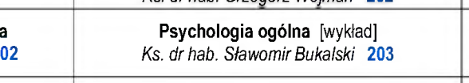
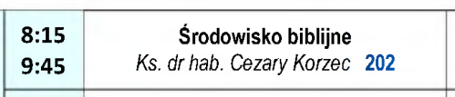
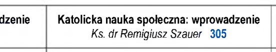
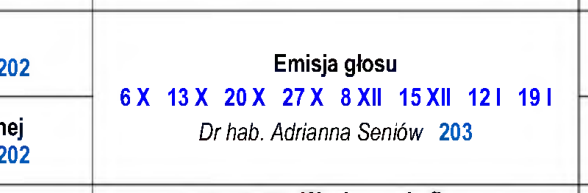
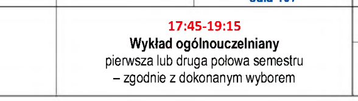
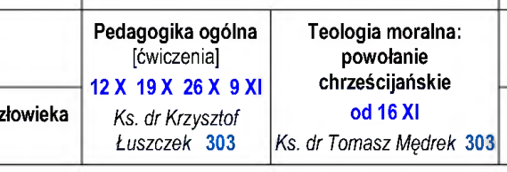
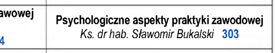
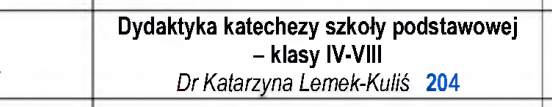
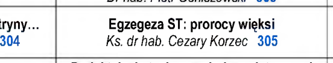
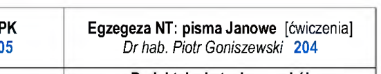

# Pilot WT (Etap 5): 10 losowych zajęć z Plan-TEO-2026-27a.pdf

Wygenerowane 2026-11-09: `node scripts/us/wt-pilot.mjs --plik Plan-TEO-2026-27a.pdf`. Plik to skan (obraz, bez tekstu) – plan pochodzi z odczytu AI `odczyty/wt/Plan-TEO-2026-27a.json` (61 zajęć), zamienionego na plan przez `scripts/us/wt-pdf.mjs`.
Przy każdym: wycinek PDF-u (kolumna roku × wiersze godzin, z kolumną godzin po lewej) i to, co trafi do planu. Ten plan NIE jest na stronie – czeka w kolejce zatwierdzeń.

## 1. 2. rok, śr. 10:00–11:30 · Psychologia ogólna

| rok | dzień | godziny | przedmiot | rodzaj | prowadzący | sala | terminy | notka |
|---|---|---|---|---|---|---|---|---|
| 2. rok | śr. | 10:00–11:30 | Psychologia ogólna | W | Ks. dr hab. Sławomir Bukalski | s. 203 | co tydzień |  |

## 2. 1. rok, wt. 08:15–09:45 · Środowisko biblijne

| rok | dzień | godziny | przedmiot | rodzaj | prowadzący | sala | terminy | notka |
|---|---|---|---|---|---|---|---|---|
| 1. rok | wt. | 08:15–09:45 | Środowisko biblijne | X | Ks. dr hab. Cezary Korzec | s. 202 | co tydzień |  |

## 3. 4. rok, czw. 08:15–09:45 · Katolicka nauka społeczna: wprowadzenie

| rok | dzień | godziny | przedmiot | rodzaj | prowadzący | sala | terminy | notka |
|---|---|---|---|---|---|---|---|---|
| 4. rok | czw. | 08:15–09:45 | Katolicka nauka społeczna: wprowadzenie | X | Ks. dr Remigiusz Szauer | s. 305 | co tydzień |  |

## 4. 2. rok, wt. 10:00–13:15 · Emisja głosu

| rok | dzień | godziny | przedmiot | rodzaj | prowadzący | sala | terminy | notka |
|---|---|---|---|---|---|---|---|---|
| 2. rok | wt. | 10:00–13:15 | Emisja głosu | CW | Dr hab. Adrianna Seniów | s. 203 | 06.10, 13.10, 20.10, 27.10, 08.12, 15.12, 12.01, 19.01 |  |

## 5. 2. rok, czw. 17:45–19:15 · Wykład ogólnouczelniany

| rok | dzień | godziny | przedmiot | rodzaj | prowadzący | sala | terminy | notka |
|---|---|---|---|---|---|---|---|---|
| 2. rok | czw. | 17:45–19:15 | Wykład ogólnouczelniany | W | — | — | co tydzień | pierwsza lub druga połowa semestru – zgodnie z dokonanym wyborem |

## 6. 3. rok, pon. 10:00–13:15 · Pedagogika ogólna

| rok | dzień | godziny | przedmiot | rodzaj | prowadzący | sala | terminy | notka |
|---|---|---|---|---|---|---|---|---|
| 3. rok | pon. | 10:00–13:15 | Pedagogika ogólna | CW | Ks. dr Krzysztof Łuszczek | s. 303 | 12.10, 19.10, 26.10, 09.11 |  |

## 7. 5. rok, wt. 11:45–13:15 · Psychologiczne aspekty praktyki zawodowej

| rok | dzień | godziny | przedmiot | rodzaj | prowadzący | sala | terminy | notka |
|---|---|---|---|---|---|---|---|---|
| 5. rok | wt. | 11:45–13:15 | Psychologiczne aspekty praktyki zawodowej | X | Ks. dr hab. Sławomir Bukalski | s. 303 | co tydzień |  |

## 8. 4. rok, wt. 11:45–13:15 · Dydaktyka katechezy szkoły podstawowej – klasy IV-VIII

| rok | dzień | godziny | przedmiot | rodzaj | prowadzący | sala | terminy | notka |
|---|---|---|---|---|---|---|---|---|
| 4. rok | wt. | 11:45–13:15 | Dydaktyka katechezy szkoły podstawowej – klasy IV-VIII | X | Dr Katarzyna Lemek-Kuliś | s. 204 | co tydzień |  |

## 9. 4. rok, wt. 10:00–11:30 · Egzegeza ST: prorocy więksi

| rok | dzień | godziny | przedmiot | rodzaj | prowadzący | sala | terminy | notka |
|---|---|---|---|---|---|---|---|---|
| 4. rok | wt. | 10:00–11:30 | Egzegeza ST: prorocy więksi | X | Ks. dr hab. Cezary Korzec | s. 305 | co tydzień |  |

## 10. 5. rok, pon. 08:15–09:45 · Egzegeza NT: pisma Janowe

| rok | dzień | godziny | przedmiot | rodzaj | prowadzący | sala | terminy | notka |
|---|---|---|---|---|---|---|---|---|
| 5. rok | pon. | 08:15–09:45 | Egzegeza NT: pisma Janowe | CW | Dr hab. Piotr Goniszewski | s. 204 | co tydzień |  |
